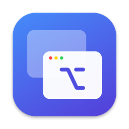

# Chojema OptSwitch

macOS용 창 전환기입니다. **Option** 키를 누른 채 **Tab**을 누르면 열린 문서(창)
사이를 이동하고, Option 키를 떼면 선택한 창으로 전환합니다. Windows의 Alt+Tab과
같은 방식입니다.

[English](README.en.md)

## 단축키

| 키 | 동작 |
|---|---|
| Option+Tab | 전환기를 열고 다음 창으로 이동 |
| Option+Shift+Tab | 이전 창으로 이동 |
| 왼쪽, 오른쪽 화살표(전환기가 열린 동안) | 앞뒤로 이동 |
| Option 키 떼기 | 선택한 창으로 전환 |
| 맨 앞의 현재 창을 고른 채 Option 키 떼기 | 취소 |

창은 최근에 사용한 순서로 표시되고, 같은 앱의 문서도 하나씩 따로 표시됩니다. 창이
없는 앱은 뒤쪽에 표시됩니다.

## 언어

앱 메뉴는 한국어로 표시됩니다. 메뉴 막대 아이콘의 **언어** 메뉴에서
**English**를 선택하면 영어로 바뀝니다.

## 요구 사항

macOS 14 이상, Apple 실리콘과 Intel Mac을 모두 지원합니다.

## 설치

1. [Releases](../../releases)에서 `Chojema-OptSwitch-<버전>.zip`을 내려받아
   압축을 풉니다.
2. `Chojema OptSwitch.app`을 `/Applications`(응용 프로그램) 폴더로 옮깁니다.
3. 앱을 엽니다. 공증되지 않은 앱이므로 처음 실행할 때 macOS가 차단합니다.
   **시스템 설정 > 개인정보 보호 및 보안**에서 **그래도 열기**를 선택합니다.
4. 앱이 권한 설정 화면과 안내 창을 함께 엽니다. 안내 창에 따라 설정 목록 맨
   아래의 **+** 버튼을 누르고, 응용 프로그램 폴더에서 **Chojema OptSwitch**를
   골라 **열기**를 누릅니다. 안내 창이 닫히면 문서별로 전환됩니다.

권한 목록은 **시스템 설정 > 개인정보 보호 및 보안**에 있습니다. macOS 27부터는
**System & App Protection Override**라는 이름입니다. 추가한 뒤 나타나는
‘Choose Apps … to Control’ 창에서 맨 아래의 **Override System Protections**를
누르고 암호나 Touch ID로 확인합니다. macOS 26까지는 **손쉬운 사용**이라는
이름이며, 추가한 뒤 스위치를 켭니다.

권한을 허용하기 전에도 Option+Tab은 동작하며, 이때는 앱별로 전환합니다.
업데이트한 뒤 문서별로 전환되지 않으면 권한 목록에서 앱을 선택해 **−** 버튼으로
지운 뒤 다시 추가합니다. 안내 창은 메뉴 막대 아이콘의 **문서별 전환 권한 안내…**에서
다시 열 수 있습니다.

## 권한이 필요한 이유

macOS에서는 다른 앱의 특정 문서 창을 앞으로 가져오고 창 제목을 읽으려면 이
권한이 필요합니다. 키 입력을 기록하거나 저장하거나 전송하지 않습니다.

## 개인정보

네트워크에 연결하지 않으며 어떤 데이터도 수집하지 않습니다.

## 라이선스

[MIT](LICENSE)
